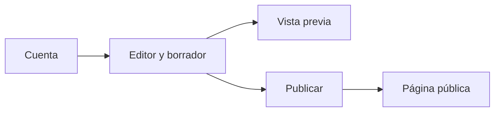
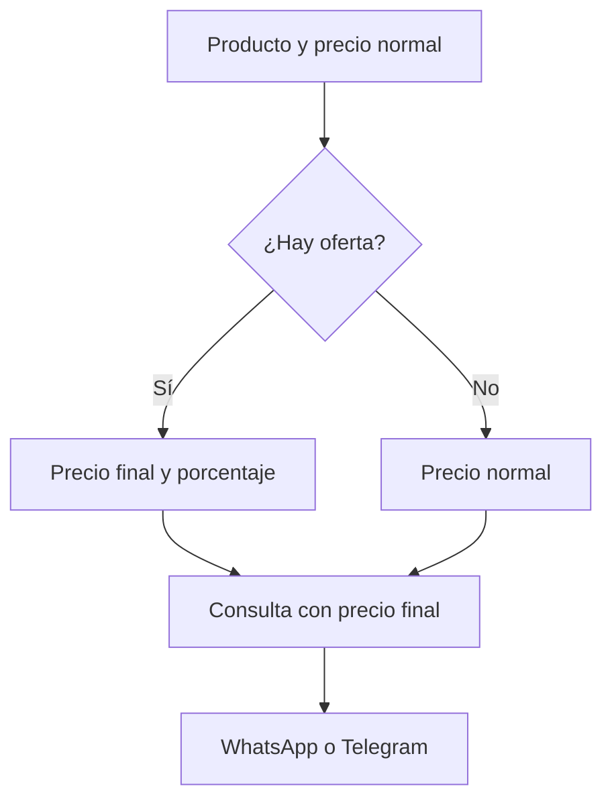
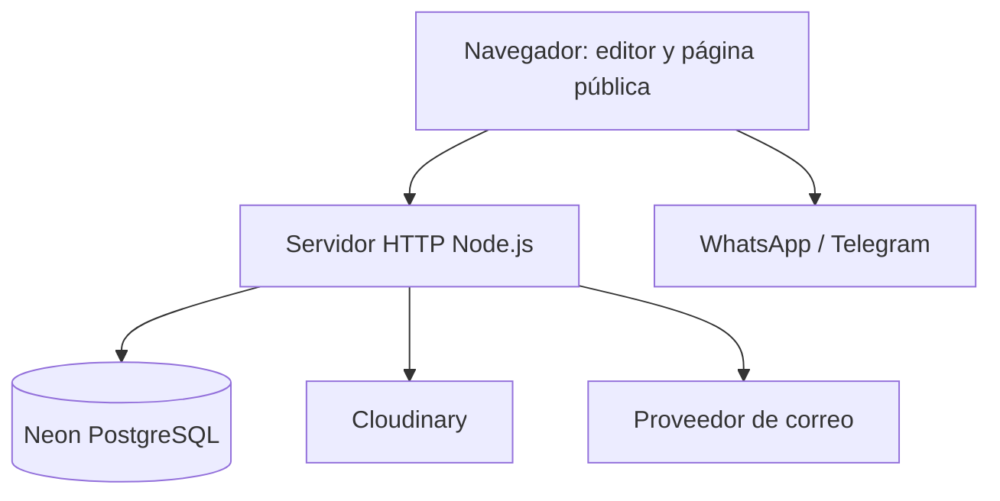
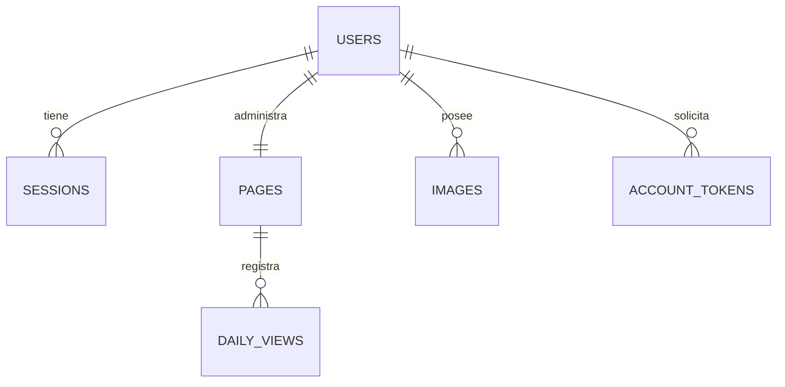

<div align="center">

# ✦ NEXO

### Tu espacio. Tu comunidad. Tu estilo.

**Una plataforma gratuita para crear páginas personales, reunir enlaces y mostrar productos y actividades en un solo lugar.**

`PERFILES` · `REDES SOCIALES` · `TIENDA` · `AVISOS` · `WHATSAPP` · `TELEGRAM`

[](https://nodejs.org/)
[](https://developer.mozilla.org/docs/Web/JavaScript/Guide/Modules)
[](https://sqlite.org/)
[](#pruebas)

[Explorar funcionalidades](#funcionalidades) · [Empezar](#inicio-rápido) · [Arquitectura](#arquitectura) · [API](#api-http) · [Estado del proyecto](#estado-y-próximos-pasos)

</div>

> **Estado: desarrollo y pruebas.** La integración de Neon y Cloudinary requiere verificación con credenciales y servicios reales. NEXO ya cuenta con una base multiusuario funcional, pero aún necesita mejoras de seguridad, moderación, infraestructura y validación antes de admitir registro público. Consulta la [auditoría técnica](docs/auditoria.md) y la [arquitectura](docs/arquitectura.md).

---

## El concepto

NEXO permite que cada persona administre un perfil y comparta una página propia:

```text
https://tu-dominio.com/u/tu-usuario
```

La persona creadora edita un **borrador privado**, comprueba la vista previa y decide cuándo publicarlo. La página pública muestra únicamente la última versión publicada.



## Funcionalidades

| Módulo | Lo que permite hacer hoy |
| --- | --- |
| **Cuenta y seguridad** | Registro, inicio de sesión, cambio de contraseña y cierre de otras sesiones. Verificación y recuperación de cuenta mediante correo configurado. |
| **Perfil** | Editar nombre, usuario, biografía, foto mediante URL, color y tema. |
| **Enlaces** | Añadir, ordenar, mostrar u ocultar enlaces. Selector con redes sociales y enlaces generales. |
| **Tienda** | Crear hasta seis productos, con imagen, precio normal y precio de oferta opcional. |
| **Descuentos** | Calcular automáticamente el porcentaje; mostrar precio normal, precio final y descuento. |
| **Contacto** | Abrir consultas por WhatsApp y/o Telegram con el producto y su precio final. La persona compradora envía el mensaje. |
| **Aviso** | Configurar un aviso con título, detalles, fecha o lugar, enlace opcional y flyer. |
| **Vista pública** | Publicar o despublicar la página y mostrar flyers sin recortarlos. |
| **Estadísticas** | Consultar solicitudes de visita agregadas por día para los últimos 30 días. No representan visitantes únicos. |
| **Demostración** | Probar el editor con datos ficticios, sin crear una cuenta ni publicar cambios. |

Las redes disponibles en el selector incluyen **Instagram, TikTok, Facebook, YouTube, WhatsApp, Telegram, X, Threads, LinkedIn, Pinterest, Snapchat, Twitch, Discord y Spotify**. También se pueden agregar enlaces generales.

### Tienda: del producto a la conversación



- La oferta debe ser menor que el precio normal. Los importes admiten hasta dos decimales; el porcentaje se redondea a dos decimales.
- La tienda **no procesa pagos**, no registra compras y no envía mensajes por cuenta del visitante.
- El número de WhatsApp o el usuario público de Telegram configurados serán visibles para las personas que consulten.

### Avisos y flyers

Cada página puede configurar hasta cinco avisos (uno principal y cuatro adicionales) con título, detalles, fecha o lugar, imagen y enlace opcional. Las imágenes cuadradas, horizontales y verticales se muestran conservando su proporción. El aviso se puede ocultar y volver a publicar la página para retirarlo de la versión pública.

---

## Inicio rápido

### Requisitos

- **Node.js 22.13 o superior**, con soporte para `node:sqlite`.
- npm, incluido habitualmente con Node.js.
- Instala las dependencias del proyecto con `npm ci`.

### Ejecutar en local

```bash
git clone https://github.com/cponce123com-create/nexo.git
cd nexo
npm ci
npm start
```

Abre **[http://localhost:3000](http://localhost:3000)** para registrarte o iniciar sesión.

Para explorar el diseño sin crear una cuenta, abre **[http://localhost:3000/demo](http://localhost:3000/demo)**. La demo utiliza datos ficticios en memoria, no publica páginas y se reinicia al salir. Las imágenes no configuradas se muestran como marcadores.

### Flujo básico de uso

1. Crea una cuenta y elige un nombre de usuario.
2. Personaliza tu perfil y agrega enlaces o redes sociales.
3. Si lo deseas, configura hasta seis productos, un aviso y tus canales de contacto.
4. Guarda el borrador y comprueba la vista previa.
5. Pulsa **Publicar** y comparte la dirección de tu página.

Si el servicio de correo está configurado, se debe verificar la cuenta antes de publicar. Para cambiar el nombre de usuario de una página publicada, primero hay que despublicarla.

## Render Free + Neon + Cloudinary

NEXO incluye una configuración para ejecutar el servidor en Render Free, guardar los datos en Neon PostgreSQL y almacenar las imágenes en Cloudinary. **La integración se ha probado con servicios simulados; falta verificarla con cuentas reales.** Consulta la [guía de configuración y comprobación](docs/render-neon-cloudinary.md).

Para una instalación nueva configura `DATABASE_URL`, `CLOUDINARY_CLOUD_NAME`, `CLOUDINARY_API_KEY`, `CLOUDINARY_API_SECRET`, `RESEND_API_KEY`, `MAIL_FROM` y `PUBLIC_URL` en Render. El archivo `render.yaml` proporciona una base para el despliegue. No existe todavía migración automática de una base SQLite previa.

## Configuración

Las variables se leen del entorno del proceso. El proyecto **no carga archivos `.env` automáticamente**: usa la configuración de tu sistema o de tu proveedor de alojamiento.

| Variable | Uso | Valor predeterminado / requisito |
| --- | --- | --- |
| `DATABASE_URL` | Conexión PostgreSQL a Neon. | Requerida en producción; usar TLS. |
| `CLOUDINARY_CLOUD_NAME`, `CLOUDINARY_API_KEY`, `CLOUDINARY_API_SECRET` | Acceso a Cloudinary desde el servidor. | Requeridas en producción. |
| `PORT` | Puerto HTTP. | `3000` |
| `DATABASE_PATH` | Ruta del archivo SQLite. | `nexo.sqlite` en el directorio de ejecución. |
| `NODE_ENV` | En `production`, activa cookies `Secure` y exige la configuración de correo al arrancar. | Sin valor predeterminado explícito. |
| `RESEND_API_KEY` | Credencial del proveedor de correo Resend. | Necesaria para enviar correos; obligatoria al arrancar en producción. |
| `MAIL_FROM` | Remitente autorizado por el proveedor. | Obligatoria al arrancar en producción. |
| `PUBLIC_URL` | Dirección base para enlaces de verificación y recuperación. | Obligatoria al arrancar en producción; usar la dirección HTTPS pública. |

Ejemplo de arranque local en Bash:

```bash
PORT=3000 DATABASE_PATH=./nexo.sqlite npm start
```

Para habilitar correo, configura las tres variables del proveedor en el entorno y utiliza un remitente autorizado. **No subas claves ni credenciales al repositorio.** La integración necesita probarse con un dominio y una cuenta reales antes de utilizarse.

En desarrollo, si falta la configuración de correo, la aplicación omite la verificación de cuentas y la recuperación por correo no estará disponible. Esa modalidad es solo para pruebas.

---

## Arquitectura

NEXO utiliza una aplicación web con módulos JavaScript y un servidor HTTP Node.js. En producción PostgreSQL almacena cuentas, páginas, sesiones, referencias de imágenes y estadísticas; Cloudinary almacena las imágenes. SQLite sigue disponible para desarrollo local. El correo se integra mediante una API externa cuando está configurado.



| Capa | Implementación actual | Responsabilidad |
| --- | --- | --- |
| Interfaz | HTML, CSS y JavaScript modular | Editor, vista previa, demostración y página pública. |
| Servidor | HTTP de Node.js | Rutas, sesiones, validación y autorización por usuario. |
| Datos | PostgreSQL con `pg`; SQLite local | Borradores, publicaciones, cuentas, archivos y visitas agregadas. |
| Imágenes | Cloudinary autenticado o URL externa; SQLite local | Productos y flyers; con límites y control básico de acceso. |
| Correo | API de Resend, opcional en desarrollo | Enlaces de verificación y recuperación. |
| Pruebas | `node:test` | Pruebas de modelo y recorridos HTTP entre cuentas. |

### Modelo de datos



Las tablas `users`, `sessions`, `pages`, `images`, `account_tokens` y `daily_views` representan los conceptos principales. El contenido del perfil, la tienda y el aviso se conserva en el borrador o la versión publicada de `pages`.

### Organización del código

| Ruta | Contenido |
| --- | --- |
| `server.js` | Arranque, configuración básica y cierre del servidor. |
| `server/app.js` | Rutas HTTP, autenticación, publicación y control de acceso. |
| `server/database.js` y `server/postgres.js` | Apertura de SQLite local y PostgreSQL. |
| `server/cloud.js` | Procesamiento y almacenamiento protegido en Cloudinary. |
| `server/security.js` | Contraseñas, tokens, sesiones y validaciones de identidad. |
| `server/images.js` | Validación inicial de imágenes importadas. |
| `server/mail.js` | Integración de correo de verificación y recuperación. |
| `src/app.js` | Editor, acciones, navegación y comunicación con la API. |
| `src/model.js` | Modelo compartido y normalización de perfiles. |
| `src/store.js` | Tienda, descuentos, imágenes y enlaces de contacto. |
| `src/notice.js` | Modelo, edición y presentación de avisos. |
| `src/preview.js` | Vista del perfil público y vista previa. |
| `src/social.js` y `src/demo.js` | Redes disponibles y datos ficticios de demostración. |
| `tests/` | Pruebas de modelos y servidor. |
| `scripts/backup.js` | Copia de seguridad de SQLite. |
| `docs/` | Arquitectura, auditoría y referencias de proyectos abiertos. |

## API HTTP

La API utiliza JSON. Las operaciones privadas requieren la cookie de sesión; las solicitudes de escritura comprueban el encabezado `Origin`.

| Método | Ruta | Función |
| --- | --- | --- |
| `POST` | `/api/register` | Crear una cuenta y su página. |
| `POST` | `/api/login` | Iniciar sesión. |
| `POST` | `/api/logout` | Cerrar la sesión actual. |
| `GET` | `/api/me` | Obtener la cuenta y su borrador. |
| `PUT` | `/api/page` | Guardar y validar el borrador. |
| `POST` | `/api/publish` | Publicar el borrador. |
| `POST` | `/api/unpublish` | Retirar la publicación. |
| `GET` | `/api/public/:usuario` | Obtener una página publicada. |
| `POST` | `/api/images` | Importar una imagen para la cuenta. |
| `GET` | `/media/:id` | Obtener una imagen autorizada o visible en una página publicada. |
| `GET` | `/api/stats` | Obtener visitas agregadas de la cuenta. |
| `POST` | `/api/verification/request` y `/api/verify` | Solicitar y completar la verificación de correo. |
| `POST` | `/api/password/forgot` y `/api/password/reset` | Solicitar y completar la recuperación de contraseña. |
| `POST` | `/api/password` y `/api/sessions/revoke` | Cambiar contraseña o cerrar otras sesiones. |

Las rutas, el esquema y los controles pueden evolucionar; consulta el código y las pruebas antes de integrarlas con otro cliente.

## Imágenes, datos y respaldos

| Recurso | Comportamiento actual |
| --- | --- |
| **Formatos** | JPG, PNG y WebP; hasta 2 MB por archivo importado. También se admiten imágenes mediante URL. |
| **Cuota** | Hasta 30 imágenes y 20 MB por cuenta. |
| **Privacidad** | Una imagen importada está disponible para su propietario y, según corresponda, cuando se usa en un producto visible o aviso publicado. |
| **Limpieza** | Al cargar otra imagen, se eliminan las imágenes sin referencias en borrador o publicación que tengan más de 24 horas. Guarda la imagen asociada antes de ese plazo. |
| **Ubicación** | En producción las imágenes importadas se guardan en Cloudinary y sus referencias en PostgreSQL; en desarrollo local se guardan en SQLite. |

Para una instalación local SQLite, crear una copia de seguridad:

```bash
node scripts/backup.js ruta/a/nexo.sqlite ruta/a/copia-nueva.sqlite
```

El destino no debe existir. Guarda la copia de forma segura y verifica periódicamente que pueda restaurarse; contiene datos privados e imágenes de las cuentas. Si usas SQLite con WAL, emplea el mecanismo de respaldo de SQLite en lugar de copiar únicamente el archivo principal mientras está en uso.

## Seguridad y privacidad

La implementación actual incluye contraseñas con `scrypt` y sal, tokens de sesión almacenados como hash, cookies `HttpOnly` y `SameSite=Lax`, comprobación de origen en escrituras y un límite básico de intentos en memoria. Los enlaces de verificación y recuperación tienen vencimiento de una hora y son de un solo uso; recuperar o cambiar la contraseña invalida sesiones.

Estas medidas son una **base inicial**. Antes de operar públicamente aún deben completarse, entre otros puntos:

- Moderación, reportes, límites de abuso y herramientas administrativas auditadas.
- Revisión de seguridad y límites de las imágenes: en Cloudinary se decodifican y reprocesan; el almacenamiento SQLite local solo comprueba la firma.
- Un sistema de límite de solicitudes compartido entre instancias, monitoreo y protección operativa.
- Pruebas reales de correo, HTTPS, políticas de privacidad, recuperación y restauración de copias.
- Pruebas visuales, de accesibilidad, carga y seguridad adicionales.

## Pruebas

```bash
npm test
```

Las pruebas cubren, entre otros recorridos, la normalización de datos, descuentos, enlaces, privacidad de imágenes y avisos, publicación, sesiones y recuperación con correo simulado. El flujo de GitHub Actions está configurado para ejecutar la suite en Node.js 22 y 24; consulta los resultados del repositorio para conocer el estado de cada ejecución.

## Estado y próximos pasos

| Prioridad | Pendiente |
| --- | --- |
| Alta | Validar la integración real de Neon y Cloudinary, respaldos y migración de instalaciones SQLite existentes. |
| Alta | Incorporar moderación, reportes y protección contra abuso. |
| Alta | Validar el correo real y reforzar el procesamiento y almacenamiento de imágenes. |
| Media | Añadir MFA, observabilidad, administración auditada y limpieza automatizada de datos. |
| Media | Ampliar bloques de contenido y estadísticas, y comprobar accesibilidad y geometría en dispositivos reales. |

El hecho de que la plataforma sea gratuita para sus usuarios no elimina los costos de infraestructura. El proyecto no incluye planes premium ni cobros integrados.

---

<div align="center">

**NEXO** · Un lugar para reunir lo que importa. ✦

[Arquitectura](docs/arquitectura.md) · [Auditoría](docs/auditoria.md) · [Referencias abiertas](docs/referencias.md)

</div>

## Compartir, estadísticas y organización

- Desde una página publicada puedes copiar su enlace y descargar un QR en formato SVG. El QR usa `PUBLIC_URL` cuando está configurada.
- Las estadísticas muestran visitas y clics agregados durante los últimos 30 días, separados por enlace o canal de contacto del producto. Son interacciones, no personas únicas; pueden incluir automatizaciones.
- El editor ofrece cuatro combinaciones de color y permite ordenar aviso, enlaces, tienda y preguntas frecuentes. Las plantillas cambian el color y el fondo, no los datos.
- Un aviso puede programarse con inicio y fin opcionales. El editor interpreta las fechas en la zona horaria del dispositivo y el servidor las evalúa como instantes UTC. Debes guardar y publicar para aplicar los cambios.
- Se pueden agregar hasta ocho preguntas frecuentes y marcar productos disponibles o agotados. Los productos agotados no generan botones de consulta.
- En Configuración puedes descargar un ZIP con los datos del perfil y las imágenes importadas de tu cuenta. No incluye estadísticas ni descarga imágenes alojadas por URL externa, y todavía no hay importación automática del ZIP.

Para aplicar las nuevas tablas de estadísticas, la aplicación crea las tablas que faltan al iniciar. La cuenta PostgreSQL debe tener permisos de creación. Comprueba con una instalación de pruebas y una copia de seguridad antes de actualizar una base de datos que contenga información real.

## Galería, avisos y moderación

- **Galería:** hasta 12 elementos entre imágenes importadas o por URL y enlaces a videos. Los videos se abren en su plataforma; NEXO no los aloja ni reproduce incrustados.
- **Avisos:** hasta cinco en total, cada uno con fechas opcionales y flyer. Los cambios requieren guardar y publicar.
- **Reportes:** las páginas públicas incluyen un formulario. Las cuentas administradoras pueden consultar los 100 reportes más recientes, descartar uno o despublicar una página; la persona creadora puede volver a publicarla. Las acciones quedan registradas en la tabla `moderation_log`. Esto aún no sustituye un sistema completo de suspensión, apelaciones o protección antispam.
- **Administración:** configura en Render `ADMIN_EMAILS` con el correo de la cuenta administradora; para varias cuentas sepáralos por comas. Deben ser correos que controles y que la cuenta haya verificado mediante el correo configurado. Si la variable está vacía, nadie tiene acceso administrativo.
- **ZIP:** incluye `perfil.json` y las imágenes importadas de la cuenta; no incluye estadísticas ni archivos alojados en URLs externas. El ZIP contiene datos privados: guárdalo de forma segura.

Las tablas de reportes y auditoría se crean al iniciar; revisa permisos de PostgreSQL y ten una copia de seguridad antes de actualizar una instalación con datos.

### Proxy de Render y conservación de imágenes

El Blueprint configura `TRUST_RENDER_PROXY=true` para identificar visitantes a través de `CF-Connecting-IP`, la cabecera que Render indica que Cloudflare sobrescribe. Actívala únicamente cuando todas las conexiones entren por el proxy de Render; en despliegues con acceso directo deja la variable desactivada, porque un cliente podría falsificar cabeceras. Si el servicio ya existía antes de actualizar el Blueprint, revisa esa variable en el panel de Render. Los límites se mantienen en memoria y se reinician con el proceso; para varias instancias se requiere un almacén compartido.

Para evitar que una limpieza compita con un guardado, las imágenes antiguas se conservan y cuentan dentro de la cuota de 30 imágenes o 20 MB por cuenta. La eliminación segura y la recuperación de espacio desde el panel todavía no están implementadas. Antes de poner el servicio a disposición de muchas personas, debe prepararse ese mecanismo y una política de retención.
